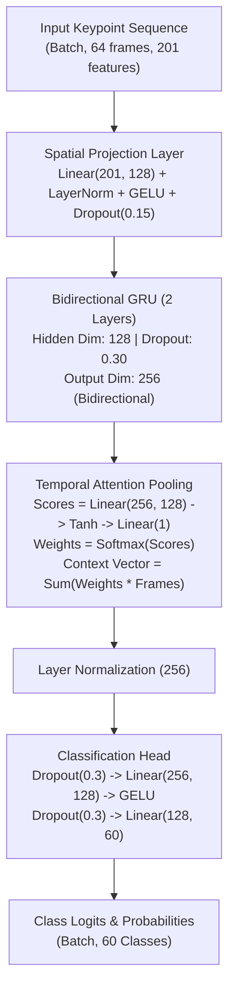

# SignBangla: Real-Time Bengali Sign Language Recognition System

[](https://www.python.org/)
[](https://pytorch.org/)
[](https://developers.google.com/mediapipe)
[](https://www.kaggle.com/datasets/hasaniut/bdslw60)

SignBangla is a complete, modular, end-to-end framework for **Bengali Sign Language (BdSL)** recognition. Built on the benchmark **BdSLW60** dataset (60 sign vocabulary across 18 signers and ~9,307 video repetitions), SignBangla bridges raw video sequences to real-time interactive inference via MediaPipe Holistic landmark extraction, robust geometric normalization, signer-independent evaluation protocols, a deep Bidirectional GRU with Temporal Attention, and a live webcam recognition HUD with bilingual (English + Bengali) output.

---

## Table of Contents

- [Key Accomplishments](#key-accomplishments)
- [Project Architecture & Directory Structure](#project-architecture--directory-structure)
- [Setup for Teammates](#setup-for-teammates)
- [Environment Setup & Installation](#environment-setup--installation)
- [Dataset Preparation](#dataset-preparation)
- [End-to-End Execution Pipeline (Step-by-Step)](#end-to-end-execution-pipeline-step-by-step)
- [Deep Learning Baseline Model](#deep-learning-baseline-model)
- [Experimental Results & Evaluation](#experimental-results--evaluation)
- [Live Real-Time Webcam Demo](#live-real-time-webcam-demo)
- [Synthetic Self-Test Suite](#synthetic-self-test-suite)
- [Phase 1 Progress Presentation Report](#phase-1-progress-presentation-report)
- [Technical Design Decisions](#technical-design-decisions)
- [Phase 2 Roadmap](#phase-2-roadmap)
- [Team & Roles](#team--roles)

---

## Key Accomplishments

1. **Full 11-Step Modular Pipeline**: Complete, reproducible pipeline spanning dataset scanning, multi-worker landmark extraction, JSON repetition segmentation, quality auditing, geometric normalization, signer-independent splitting, PyTorch DataLoaders with continuous augmentations, baseline training, evaluation, and live camera inference.
2. **Optimized 67-Keypoint Holistic Extraction**: Extracted 3D coordinates `(T, 67, 3)` (25 pose landmarks + 21 left hand + 21 right hand), dropping irrelevant lower-body points and face mesh to maximize extraction speed (~30+ FPS) and prevent facial appearance overfitting.
3. **Robust Segment Cutting & Quality Auditing**: Parsed JSON timestamp files across multiple naming variants (`actual start`, `gesture end`, etc.) to cut continuous video recordings into isolated sign repetitions (~9,307 trials). Built automated QA filtering for tracking drops, missing hands, and short clips with visual diagnostic skeleton plots.
4. **Coordinate Invariance & Resampling**: Implemented shoulder-centered geometric normalization, shoulder-width distance scaling, temporal missing-hand gap interpolation (up to 6 frames), and linear temporal interpolation to a uniform 64-frame sequence `(64, 67, 3)`.
5. **Strict Signer-Independent Protocol**: Set aside signers **U4** and **U8** strictly for testing (matching the published benchmark paper) and **U1** / **U11** for validation to guarantee zero subject identity leakage across splits.
6. **BiGRU Baseline Classifier**: Designed a 2-layer Bidirectional GRU model with spatial projection, LayerNorm, and learned Temporal Attention pooling (`scripts/10_train_baseline.py`). Results are pending retraining on the full split.
7. **Real-Time Live Webcam Application**: Deployed an interactive live demo (`scripts/11_live_webcam_demo.py`) with a semi-transparent HUD displaying predicted sign names in both English and native Bengali script (e.g., *Father / বাবা*, *Relative / আত্মীয়*), real-time class probability bars, sequence buffer fill status, and FPS monitoring.
8. **Formal Presentation Report**: Authored an automated ReportLab report generator (`scripts/generate_progress_pdf.py`) compiling a publication-quality 5-page presentation document (`SignBangla_Phase1_Progress_Presentation.pdf`).

---

## Project Architecture & Directory Structure

```text
signbangla_phase1/
├── configs/
│   └── config.yaml                     # Central YAML configuration (paths, quality, augment, splits)
├── data/
│   └── BdSLW60/                        # Kaggle dataset root (W1-2, W3-4, ..., W359-360)
├── scripts/
│   ├── 01_inspect_dataset.py           # Step 1: Scan video files, resolutions, FPS & annotations
│   ├── 02_test_mediapipe.py            # Step 2: Validate MediaPipe Holistic on sample videos / camera
│   ├── 03_extract_keypoints.py         # Step 3: Multi-worker resumable keypoint extraction (T, 67, 3)
│   ├── 04_build_trials.py              # Step 4: Cut videos into sign repetitions via JSON annotations
│   ├── 05_check_quality.py             # Step 5: QA analysis, flag bad trials, skeleton plots
│   ├── 05b_preview_trial.py            # Step 5b: Overlay landmarks onto video frames for visual audit
│   ├── 06_preprocess.py                # Step 6: Shoulder centering, scale normalization, gap filling, 64 frames
│   ├── 07_make_splits.py               # Step 7: Zero-leakage signer-independent train/val/test splits
│   ├── 08_test_dataloader.py           # Step 8: PyTorch DataLoader verification & augmentation check
│   ├── 09_eval_demo.py                 # Step 9: Evaluation tools demonstration & mock evaluation
│   ├── 10_train_baseline.py            # Step 10: Train BiGRU baseline with Cosine Annealing & attention
│   ├── 11_live_webcam_demo.py          # Step 11: Real-time live webcam recognition with interactive HUD
│   ├── download_dataset.py             # Stream-download & extract BdSLW60 directly from Kaggle API
│   └── generate_progress_pdf.py        # Generate publication-quality 5-page progress presentation PDF
├── signbangla/                         # Core Python package
│   ├── __init__.py                     # Package init
│   ├── annotations.py                  # Flexible JSON annotation loading & frame boundary parsing
│   ├── dataset.py                      # SignBanglaDataset, Augmenter, DataLoaders & class weights
│   ├── keypoints.py                    # MediaPipe Holistic wrapper & 67-point selector
│   ├── labels.py                       # 60 BdSL word definitions (English/Bengali) & stem parsers
│   ├── metrics.py                      # Accuracy, F1, precision, recall, confusion matrix & plotters
│   ├── models.py                       # BiGRUClassifier & TemporalAttention neural network models
│   ├── pipeline.py                     # High-level pipeline execution functions
│   ├── preprocess.py                   # Geometric normalization, gap interpolation, resampling, mirroring
│   ├── quality.py                      # Trial quality calculation & threshold validation
│   ├── utils.py                        # YAML loader, atomic file savers, path resolvers
│   └── viz.py                          # 2D/3D skeleton rendering & connection graphs
├── tests/
│   └── test_pipeline.py                # End-to-end self-test suite on synthetic data
├── work/                               # Not in git: data comes from the Google Drive zip, the rest from scripts
│   ├── manifest.csv                    # Dataset video inventory (FPS, resolution, signer, word)
│   ├── raw_keypoints/                  # Full-video extracted landmarks (T, 67, 3) .npy + .json
│   ├── trials/                         # Segmented sign repetition keypoints (T, 67, 3)
│   ├── trials_metadata.csv             # Metadata of all cut repetitions
│   ├── quality_report.csv              # Quality statistics & error flags per trial
│   ├── quality_plots/                  # Skeleton diagnostic visual plots
│   ├── processed/                      # Normalized, interpolated, 64-frame sequences (64, 67, 3)
│   ├── processed_metadata.csv          # Metadata for all clean processed trials
│   ├── splits.csv                      # Signer split assignment (train, val, test)
│   ├── split_summary.txt               # Verification report of signer splits
│   └── results/                        # Made by training, not in the zip
│       └── bigru/                      # Baseline trained model weights, metrics & curves
│           ├── best_model.pt           # Best checkpoint based on validation loss/accuracy
│           ├── history.json            # Training and validation loss/acc/F1 curves across epochs
│           ├── test_metrics.json       # Final test evaluation metrics
│           ├── test_per_class.csv      # Per-class precision, recall, F1, support
│           ├── test_confused_pairs.csv # Top confusing sign pairs
│           ├── test_confusion_matrix.png # High-resolution confusion matrix heatmap
│           └── training_curves.png     # Loss and accuracy evolution plot
├── requirements.txt                    # Project dependencies
├── SignBangla_Phase1_Progress_Presentation.pdf # Progress presentation document, not in git
├── TEAM_NOTES.md                       # Module ownership, shared-file rule, recent shared changes
└── README.md
```

---

## Setup for Teammates

Do this after cloning the repo. The commands are for Windows PowerShell, run from the project folder.

### 1. Python version

Use **Python 3.11**. `mediapipe==0.10.14` does not install on Python 3.13 or newer.

### 2. Create the environment and install

```powershell
py -3.11 -m venv .venv
.venv\Scripts\activate
python -m pip install --upgrade pip
```

### 3. Install PyTorch with CUDA (NVIDIA GPU)

Install this **before** `requirements.txt`, otherwise you download the CPU build first and replace it afterwards. It is about a 2 GB download. `nvidia-smi` must show `CUDA Version` 13.2 or higher; if not, update your NVIDIA driver.

```powershell
pip install "torch==2.15.0+cu132" --index-url https://download.pytorch.org/whl/cu132
python -c "import torch; print(torch.__version__, torch.cuda.is_available())"
```

The second line must print `2.15.0+cu132 True`. Without an NVIDIA GPU, skip this step: `requirements.txt` installs the CPU build.

### 4. Install everything else

```powershell
pip install -r requirements.txt pytest
```

### 5. Unzip the data archive

Nothing in `work\` is in git. The data there comes from `signbangla_keypoints.zip` on the team's Google Drive: `raw_keypoints\`, `processed\`, `trials\`, `sign_dictionary\`, the CSV files and `split_summary.txt`.

Unzip it into the **project folder**. It already contains the `work\` level, so you must end up with `work\raw_keypoints\` and `work\processed\`, not `work\work\`:

```powershell
Expand-Archive signbangla_keypoints.zip -DestinationPath .
```

With this archive you can train and evaluate (`scripts/08` onward) and run the Module 2 scripts (`scripts/20_*`) without the videos.

The other folders in `work\` are not in the archive, because scripts create them: `results\` (`scripts/10`), `quality_plots\` (`scripts/05`), `eval_demo\` (`scripts/09`) and `mediapipe_test\` (`scripts/02`).

To rerun `scripts/01` to `07`, you also need the videos, about 24 GB. They are not in git. Use the Kaggle CLI:

```powershell
pip install kaggle
kaggle datasets download hasaniut/bdslw60 -p data/BdSLW60 --unzip
```

### 6. Run the tests

```powershell
python -m pytest -q tests
```

All tests must pass. They use synthetic data, so they do not need the videos or the archive.

Before changing anything, read `TEAM_NOTES.md`: it lists who owns what and the rule for changing shared files.

---

## Environment Setup & Installation

### 1. Prerequisites
- **Python**: 3.11 (required).
- **OS**: macOS (Apple Silicon / Intel), Linux, or Windows.
- **Hardware**: CPU works for all steps; Apple Silicon (MPS) or NVIDIA GPU (CUDA) accelerates PyTorch baseline training.

### 2. Virtual Environment Setup

```bash
# Clone the repository
git clone <repo-url>
cd signbangla_phase1

# Create and activate virtual environment
python -m venv venv
# On Linux/macOS:
source venv/bin/activate
# On Windows:
venv\Scripts\activate

# Install dependencies
pip install -r requirements.txt

# Install PyTorch matching your hardware (see pytorch.org for specific CUDA builds)
pip install torch torchvision
```

> [!IMPORTANT]
> **MediaPipe Version**: `mediapipe==0.10.14` is strictly pinned in `requirements.txt`. Newer versions (0.10.15+) deprecated or removed the legacy `mp.solutions.holistic` API used for simultaneous pose and dual-hand keypoint extraction.

---

## Dataset Preparation

The benchmark dataset used is **BdSLW60** (Bengali Sign Language 60 Words), published by Hasan et al.:
- **Vocabulary**: 60 isolated Bengali signs representing common familial, conversational, object, and health terms.
- **Signers**: 18 native signers recorded in front-view (`F`).
- **Structure**: Each video captures 10 to 15 continuous repetitions of a single sign, with accompanying JSON annotation files defining the start and end frame indices for each repetition.

### Option A: Kaggle CLI (Recommended)
This downloads the zip of about 25 GB, unzips it, then deletes the zip, so you need room for both during the download:

```bash
pip install kaggle
kaggle datasets download hasaniut/bdslw60 -p data/BdSLW60 --unzip
```

### Option B: Streaming Script (`scripts/download_dataset.py`)
> [!NOTE]
> Kaggle now accepts the script's first request, but a full download has not been tested since that fix. If it fails, use Option A or C.

The script extracts files straight from the download stream, so no 25 GB zip is stored. It needs two packages that are not in `requirements.txt`:

```bash
pip install requests stream-unzip
python scripts/download_dataset.py --output data/BdSLW60
```

| Option | Default | Meaning |
| :--- | :--- | :--- |
| `--output` | `data/BdSLW60` | Folder to extract into |
| `--limit N` | no limit | Stop after extracting N files |
| `--words W1-2 W3-4` | all folders | Only extract these word folders (`.json`, `.csv`, `.txt` and `.pdf` files are always extracted) |

It looks for Kaggle credentials in this order: the `KAGGLE_API_TOKEN` environment variable, `~/.kaggle/access_token`, then `~/.kaggle/kaggle.json`.

### Option C: Manual Download
1. Download `bdslw60.zip` from Kaggle: [hasaniut/bdslw60](https://www.kaggle.com/datasets/hasaniut/bdslw60).
2. Extract the archive into `data/BdSLW60` such that word folders (`W1-2`, `W3-4`, etc.) sit directly inside `data/BdSLW60`.
3. Check `paths.dataset_root: "data/BdSLW60"` in `configs/config.yaml`.

---

## End-to-End Execution Pipeline (Step-by-Step)

| Step | Script | Primary Module | Description | Key Output / Verification |
| :---: | :--- | :--- | :--- | :--- |
| **01** | `python scripts/01_inspect_dataset.py` | `pipeline.py` | Scans dataset root, probes video metadata (FPS, width, height, total frames), validates JSON annotations. | `work/manifest.csv`<br>`video_counts_signer_by_word.csv` |
| **02** | `python scripts/02_test_mediapipe.py` | `keypoints.py` | Validates MediaPipe Holistic landmark extraction on 5 sample videos and live webcam (`--webcam`). | `work/mediapipe_test/`<br>Verifies 67 landmarks shape `(T, 67, 3)` |
| **03** | `python scripts/03_extract_keypoints.py` | `keypoints.py` | Multi-worker keypoint extraction across videos. Resumable; tracks progress in CSV log. | `work/raw_keypoints/*.npy`<br>`work/extract_log.csv` |
| **04** | `python scripts/04_build_trials.py` | `annotations.py` | Parses annotation JSONs and cuts continuous video keypoints into individual sign trials. | `work/trials/*.npy`<br>`work/trials_metadata.csv` (~9,307 trials) |
| **05** | `python scripts/05_check_quality.py` | `quality.py` | Audits segmented trials for minimum frames, pose fraction, and hand visibility. Flags outliers. | `work/quality_report.csv`<br>`work/bad_trials.csv`<br>`work/quality_plots/*.png` |
| **05b** | `python scripts/05b_preview_trial.py <id>` | `viz.py` | Overlays extracted keypoint skeleton onto raw video frames to verify annotation alignment. | Visual inspection window |
| **06** | `python scripts/06_preprocess.py` | `preprocess.py` | Centers at shoulder midpoint, scales to unit shoulder width, interpolates hand gaps, resamples to 64 frames. | `work/processed/*.npy` `(64, 67, 3)`<br>`work/processed_metadata.csv` |
| **07** | `python scripts/07_make_splits.py` | `pipeline.py` | Creates signer-independent train/val/test splits (Test: U4, U8; Val: U1, U11; Train: 14 signers). | `work/splits.csv`<br>`work/split_summary.txt` |
| **08** | `python scripts/08_test_dataloader.py` | `dataset.py` | Verifies PyTorch `SignBanglaDataset`, batch loading, feature flattening `(B, 64, 201)`, and augmentations. | Validates augmentation pipeline without corrupting absent hand states |
| **09** | `python scripts/09_eval_demo.py` | `metrics.py` | Runs demo evaluation suite calculating accuracy, F1, confusion matrices, and confused sign pairs. | `work/eval_demo/` verification artifacts |
| **10** | `python scripts/10_train_baseline.py` | `models.py` | Trains deep BiGRU baseline with Temporal Attention pooling, Cosine Annealing, and checkpointing. | `work/results/bigru/best_model.pt`<br>`test_metrics.json`, `training_curves.png` |
| **11** | `python scripts/11_live_webcam_demo.py` | Real-time | Real-time live inference from camera with interactive HUD, bilingual sign names, and probability gauges. | Interactive real-time window at 30+ FPS |

---

## Deep Learning Baseline Model

The baseline classifier (`signbangla/models.py`) is formulated specifically for sequence-based skeleton dynamics:



### Architectural Highlights
- **Spatial Linear Projection**: Maps raw 201 flattened coordinates (67 keypoints × 3 dimensions) into a 128-dimensional latent space before recurrence, regularized by LayerNorm.
- **Bidirectional Recurrence**: 2-layer BiGRU captures forward and backward gesture articulation dynamics.
- **Learned Temporal Attention**: Replaces simple average pooling with an attention mechanism that selectively weights the apex frames of the sign gesture while discounting transition/neutral frames.
- **Cosine Annealing & Balanced Loss**: Optimized with AdamW (`lr=1e-3`, `weight_decay=1e-4`), CosineAnnealingLR, and inverse frequency class weighting.

### Training Command
```bash
# Train on Apple Silicon (MPS), CUDA, or CPU
python scripts/10_train_baseline.py --epochs 40 --batch-size 32 --lr 0.001 --device auto
```

---

## Experimental Results & Evaluation

**Results are pending retraining on the full split.**

| Split | Signers | Trials |
| :--- | :--- | :---: |
| Train | 14 signers | 5,558 |
| Validation | U1, U11 | 1,667 |
| Test | U4, U8 | 1,060 |

Once the model is retrained, this section will report accuracy, macro F1 and the confusion matrix on the test signers, who are never seen during training or validation.

Training writes its outputs to `work/results/bigru/`, which is not in git:
- `test_confusion_matrix.png` (Confusion matrix heatmap)
- `training_curves.png` (Epoch loss and accuracy trajectories)

---

## Live Real-Time Webcam Demo

The live camera system (`scripts/11_live_webcam_demo.py`) runs at 30+ FPS and performs real-time continuous inference directly from a standard computer webcam. It needs a trained checkpoint, and `work/results/` is not in git, so run `scripts/10_train_baseline.py` first:

```bash
# Launch live recognition using default webcam
python scripts/11_live_webcam_demo.py

# Specify custom camera index or checkpoint
python scripts/11_live_webcam_demo.py --camera 0 --checkpoint work/results/bigru/best_model.pt
```

### Real-Time Features
- **Live 67-Keypoint Extraction**: Tracks upper body pose and both hands in real-time.
- **Dynamic Sliding Buffer**: Maintains a continuous temporal window of recent frames and performs on-the-fly shoulder normalization and linear resampling to 64 frames.
- **Bilingual Glassmorphic HUD**: Displays the top predicted sign in English and Bengali script (e.g., `Father / বাবা`), detection confidence percentage, and buffer fill level.
- **Top-3 Prediction Probability Bars**: Visualizes candidate probabilities in real-time.
- **FPS & Skeleton Toggle**: Press `s` to toggle keypoint skeleton overlay; press `q` to exit.

---

## Synthetic Self-Test Suite

To guarantee pipeline integrity across any machine without needing the full 25GB dataset, we built a comprehensive synthetic test suite:

```bash
python tests/test_pipeline.py
```

### What It Tests:
- Synthesizes 1,080 dummy trials (18 signers × 60 classes) with realistic shoulder landmarks and sinusoidal hand trajectories.
- Tests multiple JSON annotation structures (including alternative regex key patterns).
- Validates trial segmentation, QA filtering, shoulder normalization, gap filling, and resampling.
- Tests signer-independent splitting, PyTorch DataLoader batch generation, spatial/temporal augmentations, and metric evaluation.
- Outputs `ALL TESTS PASSED` in under 5 seconds.

---

## Phase 1 Progress Presentation Report

We created an automated report generation script (`scripts/generate_progress_pdf.py`) utilizing ReportLab to compile a formal 5-page presentation document:

The PDF is not in git. To make it, install ReportLab, which is not in `requirements.txt`:

```bash
pip install reportlab
python scripts/generate_progress_pdf.py
```

### Document Structure (`SignBangla_Phase1_Progress_Presentation.pdf`):
- **Page 1: Executive Overview, Team Roles & 10-Week Master Timeline**: Project objectives, BdSLW60 benchmark metrics, and work division.
- **Page 2: Member 1 (Wahiduzzaman Mahin) - Extraction, Segmentation & QA**: Dataset inspection, MediaPipe Holistic extraction, repetition segmentation, and quality audit with skeleton diagnostic visuals.
- **Page 3: Member 2 - Pipeline Architecture, Normalization & PyTorch DataLoaders**: Coordinate normalization, missing hand gap filling, uniform resampling, and PyTorch augmentations.
- **Page 4: Member 3 - Real-Time Extraction, Signer Splits & Evaluation**: Real-time webcam pipeline, zero-leakage split strategy, BiGRU test evaluation, and confusion analysis.
- **Page 5: System Integration Verification & Phase 2 Roadmap**: Full-pipeline integration checks, live webcam demo preview, and Weeks 4–10 modeling roadmap.

---

## Technical Design Decisions

| Decision | Selection | Rationale |
| :--- | :--- | :--- |
| **Landmark Selection** | **67 Keypoints** (25 pose + 21 left hand + 21 right hand) | Dropped lower-body pose (hips down) and 468-point face mesh. Focuses representation on communicative articulators, prevents facial identity overfitting, and boosts processing speed to 30+ FPS. |
| **Coordinate Origin** | **Shoulder Midpoint** `(L + R) / 2` | Ensures invariant spatial representation regardless of where the signer sits in the video frame. |
| **Spatial Scaling** | **Shoulder Width** `‖L - R‖₂` | Normalizes for varying distances from the camera and different signer body statures. |
| **Missing Hand Strategy** | **Interpolate $\le$ 6 frames; else zero** | Short hand tracking losses (occlusions) are smoothly bridged via linear interpolation; permanently absent hands remain exactly zero to avoid phantom hand hallucinations. |
| **Uniform Sequence Length** | **64 Frames** | Resamples variable sign durations (6 to 164 frames; mean 36.3 frames, or 44.3 at 30 fps) to a power of two, matching PyTorch batching and GPU tensor alignment. |
| **Hand Dominance** | **Preserve Original Hands** (`mirror_left_dominant: false`) | BdSLW60 contains ~17% left-handed trials. Following the project specification, mirroring is disabled by default to maintain natural distribution, with a modular switch (`--mirror-left`) available for ablation studies. |
| **Splitting Strategy** | **Signer-Independent (14 / 2 / 2)** | Signers U4 and U8 are reserved strictly for the test set to directly match the published literature benchmark and evaluate true generalization to unseen individuals. |

---

## Phase 2 Roadmap

Building upon the established Phase 1 pipeline and BiGRU baseline:

```mermaid
gantt
    title SignBangla Phase 2 Development Roadmap
    dateFormat  YYYY-MM-DD
    section Week 4
    Baseline Training & Live Demo             :done,    2026-10-01, 2026-10-07
    section Weeks 5-6
    Spatial-Temporal Graph CNNs (ST-GCN)     :active,  2026-10-08, 2026-10-21
    Ablation: Hand Dominance & 2D vs 3D     :         2026-10-15, 2026-10-21
    section Weeks 7-8
    Spatial-Temporal Transformers (ST-Tr)    :         2026-10-22, 2026-11-04
    Continuous Gesture Boundary Detection    :         2026-10-29, 2026-11-04
    section Weeks 9-10
    System Optimization & Deployment        :         2026-11-05, 2026-11-18
    Final Report & Project Presentation      :         2026-11-12, 2026-11-18
```

1. **Graph Convolutional Networks (Weeks 5-6)**: Implement ST-GCN and CTR-GCN architectures using the natural skeletal graph adjacency matrix of the human upper body and hands.
2. **Spatial-Temporal Transformers (Weeks 7-8)**: Train self-attention architectures across both joint spatial connections and temporal frames to better separate fine-grained finger movements.
3. **Continuous Sentence Recognition (Weeks 8-9)**: Transition from isolated sign recognition to continuous Bengali sentence translation with Connectionist Temporal Classification (CTC).
4. **Edge Deployment & Web Interface (Weeks 9-10)**: Export optimized ONNX models and package a user-friendly browser/desktop application for real-time assistive translation.

---

## Team & Roles

- **Member 1 (MD. Konok-Uz-Zaman)**: *Data & Model Lead*  
  BdSLW60 dataset inspection, MediaPipe Holistic keypoint extraction pipeline, repetition segmentation & quality assurance, BiGRU architecture, and Transformer model development.
- **Member 2 (Wahiduzzaman Mahin)**: *Training & Evaluation Lead*  
  Development environment setup, coordinate normalization (shoulder-centered & scale-invariant), temporal gap-filling & 64-frame resampling, PyTorch `SignBanglaDataset` & `DataLoader` with augmentations, training pipeline with early stopping, hyperparameter tuning, and comprehensive metric evaluation.
- **Member 3 (Shesir Baidya)**: *Real-Time System & Demo Lead*  
  Webcam MediaPipe testing, signer-independent train/val/test splitting strategy (preventing data leakage), real-time rolling sequence buffer, live prediction inference, bilingual skeleton HUD overlay, and gTTS speech integration.
