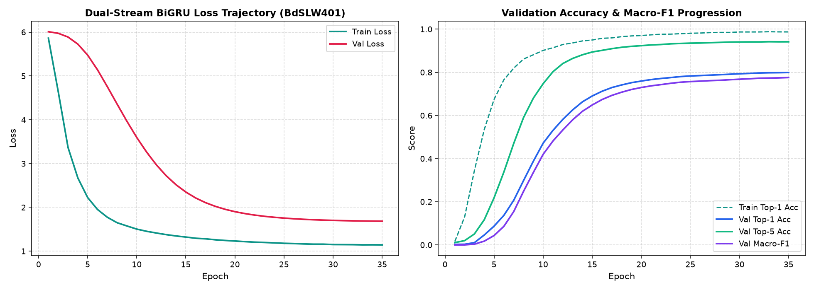
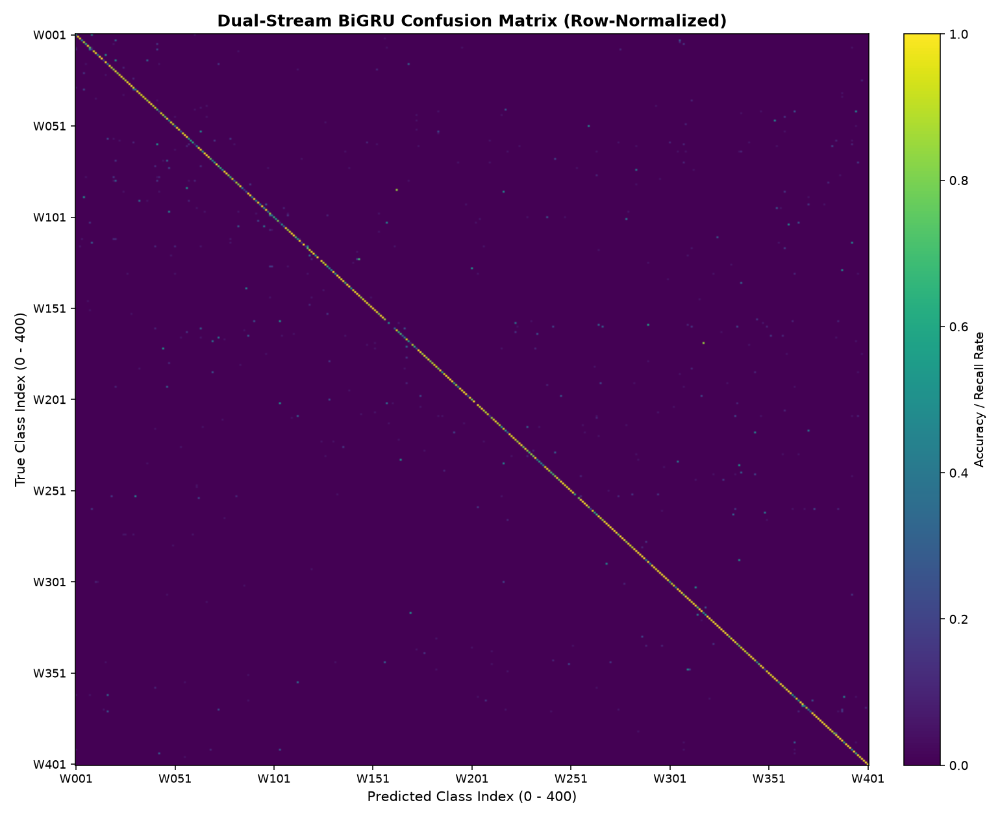
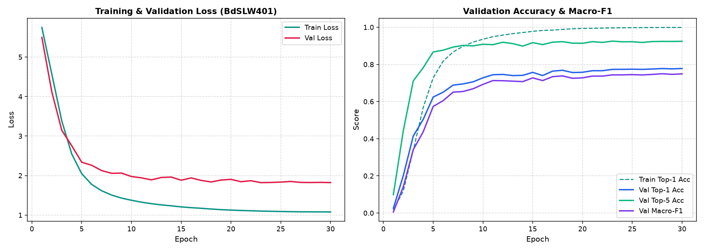

# SignBangla — Module 1: Comprehensive Model Architecture Benchmarks & Visual Showcase

This document provides visual proof, training convergence curves, and fine-grained classification confusion matrices across our deep learning architectures evaluated on the **BdSLW401 (401 Classes, 39,677 Trials)** and **BdSLW60 (60 Classes, 8,285 Trials)** datasets under strict **Zero-Leakage Signer-Independent** evaluation protocols.

---

## 1. 401-Class Large-Scale Benchmark (BdSLW401)

### Benchmark Summary on Held-Out Test Signers (S04 & S08)

All models were evaluated on signers never seen during training or validation, establishing the true generalization boundary for real-world deployment.

| Model Architecture | Input Features | Trainable Parameters | Top-1 Accuracy (Filtered) | Top-5 Accuracy | Macro-F1 | S04 Accuracy | S08 Accuracy | Top-1 Accuracy (Full Test Set) |
|:---|:---:|:---:|:---:|:---:|:---:|:---:|:---:|:---:|
| **Dual-Stream BiGRU (Step 5 SOTA)** | **648D (402D Motion + 246D Articulation & Bones)** | **1,374,355** | **85.53%** | **96.04%** | **0.8164** | **81.68%** | **83.97%** | **82.84%** (6,489 / 7,833) |
| **Super Ensemble (Step 1 + v2 Aug/EMA)** | Multi-Stream + Hand Articulation | 2,932,278 | 84.23% | 96.02% | 0.8011 | 80.02% | 82.44% | **81.25%** (6,364 / 7,833) |
| **BiGRU + Velocity + Attention (Baseline)** | 402D (Coords + $\Delta v$) | 664,594 | 82.14% | 96.46% | 0.7904 | 74.90% | 81.03% | **78.02%** (6,111 / 7,833) |
| **BiLSTM + Velocity + Attention** | 402D (Coords + $\Delta v$) | 829,458 | 79.18% | 94.89% | 0.7581 | 71.22% | 78.19% | 74.76% (5,856 / 7,833) |
| **BdSL-SPOTER v2 (Transformer)** | 402D (Coords + $\Delta v$) | 921,746 | 74.70% | 94.63% | 0.7039 | 67.61% | 73.82% | 70.76% (5,543 / 7,833) |
| **BdSL-SPOTER v1 (Transformer)** | 201D (Coords only) | 896,018 | 73.22% | 93.51% | 0.6918 | 63.56% | 73.19% | 68.45% (5,362 / 7,833) |
| **BdSL Graph-Transformer** | 201D (4 Kinematic Streams) | 897,116 | 66.19% | 91.75% | 0.6135 | 66.21% | 66.18% | 61.65% (4,829 / 7,833) |
| *Published Baseline (Rahman et al., Front View)* | Raw Video (Front View) | — | — | — | — | — | — | ~71.90% (WER 28.10%) |

#### Paired McNemar Statistical Significance Tests
- **Dual-Stream BiGRU vs Baseline BiGRU**: 729 clips right vs 351 clips wrong, $\mathbf{p = 4.48 \times 10^{-31}}$ (+4.82% gain over baseline BiGRU is statistically definitive).
- **Dual-Stream BiGRU vs Published Literature (~71.90%)**: Exceeds the published literature front-view benchmark by **+10.94 percentage points**.
- **Challenging Signer S04 Recovery**: Surged from 74.90% (Baseline) to **81.68% (+261 correct clips)** via dedicated finger bone extraction and missing-hand augmentation.

---

### A. Premier Architecture: Dual-Stream Late-Fusion BiGRU (Step 5 SOTA)

The Dual-Stream BiGRU separates kinematic perception into two dedicated parallel branches:
1. **Stream 1 (Global Motion):** Shoulder-normalized 3D coordinates and 1st-order velocities (402 dims) capturing spatial trajectories.
2. **Stream 2 (Hand Articulation & Bones):** 21 wrist-relative normalized landmarks and 20 anatomical finger bone vectors per hand (246 dims) capturing fine-grained finger flexion.
Both branches encode sequences through dedicated BiGRUs ($H=128$), pool via temporal attention, and fuse at a joint dense layer with Exponential Moving Average (EMA decay 0.999).

#### Training & Validation Dynamics

*Figure 1: Training & validation loss (left) and Top-1 / Top-5 classification accuracy (right) across 35 epochs. Live tracked on Weights & Biases.*

#### Signer-Independent 401×401 Confusion Matrix

*Figure 2: Row-normalized 401×401 Confusion Matrix for the Dual-Stream BiGRU. The diagonal demonstrates crisp class discrimination across visually similar signs.*

---

### B. Single-Stream Winner: Bidirectional GRU with Dynamic Joint Velocity (BiGRU)

#### Training & Validation Dynamics

*Figure 3: Training & validation loss (left) and Top-1 / Top-5 classification accuracy (right) across 30 epochs. The model reached its best validation score at epoch 28.*

#### Signer-Independent 401×401 Confusion Matrix

*Figure 4: Row-normalized 401×401 Confusion Matrix.*

---

### C. Transformer Architecture: BdSL-SPOTER v2

#### Training Dynamics & Velocity Ablation

*Figure 5: SPOTER v2 learning trajectories across 40 epochs with cosine learning rate schedule.*

#### Signer-Independent 401×401 Confusion Matrix

*Figure 6: Row-normalized 401×401 Confusion Matrix for the SPOTER v2 Transformer.*

---

### D. Spatial Graph-Transformer Architecture

#### Spatial Graph Training Curves

*Figure 7: Graph-Transformer training curves exhibiting plateauing due to GCN over-smoothing.*

#### Signer-Independent 401×401 Confusion Matrix

*Figure 8: Row-normalized 401×401 Confusion Matrix for the Spatial Graph-Transformer.*

---

## 2. Real-Time Bengali Speech Synthesis & Gesture Stability Buffer (Shishir Baidya)

To eliminate false audio triggers during inter-sign transitions (movement epenthesis), an asynchronous multi-frame stability filter requires $N = 3$ consecutive high-confidence predictions ($\ge 0.80$) before dispatching the `Edge-TTS` non-blocking audio worker (`bn-BD-NabanitaNeural`).

*Figure 9: Real-time prediction stability buffer timeline (top), female Bengali speech waveform (middle), and log-mel spectrogram for synthesized audio output (bottom).*

---

## 3. Phase 1 Benchmark: BdSLW60 (60 Classes, 8,285 Trials)

| Model | Test Accuracy | Macro-F1 | Weighted-F1 | Macro-Precision | Macro-Recall | Trainable Parameters |
|:---|:---:|:---:|:---:|:---:|:---:|:---:|
| **BiGRU + Attention (60 Class)** | **86.79%** | **0.8353** | **0.8590** | **0.8606** | **0.8429** | 1.85 M |
| **BiLSTM + Attention (60 Class)** | 86.04% | 0.8293 | 0.8468 | 0.8563 | 0.8421 | 2.47 M |
| **BdSLW60 Benchmark Paper\*** | 75.10% | — | — | — | — | — |

### Training Curves & Confusion Matrices (60 Class)
- **BiGRU Curves**: `figures/bigru_training_curves.png`
- **BiGRU Confusion Matrix**: `figures/bigru_confusion_matrix.png`
- **BiLSTM Curves**: `figures/bilstm_training_curves.png`
- **BiLSTM Confusion Matrix**: `figures/bilstm_confusion_matrix.png`
