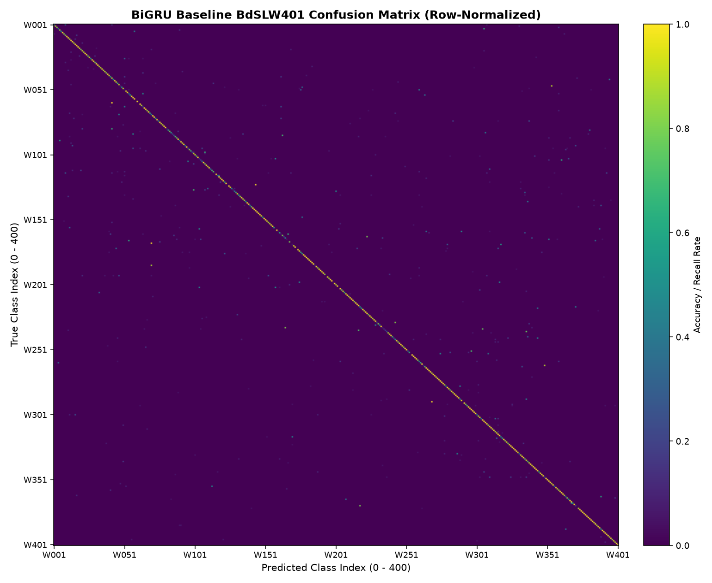
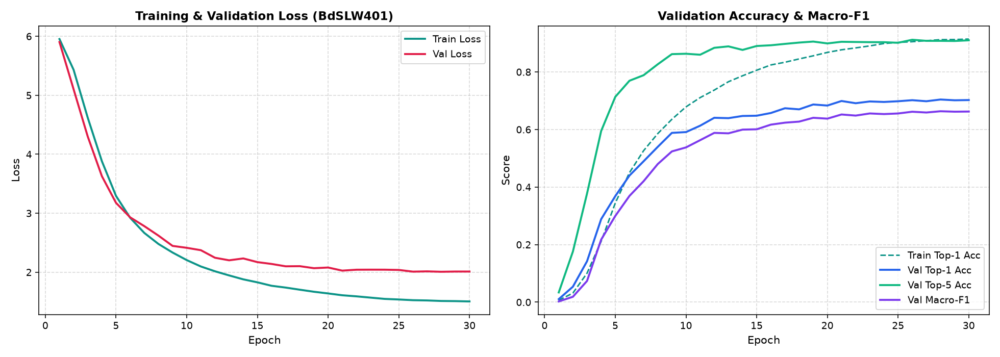
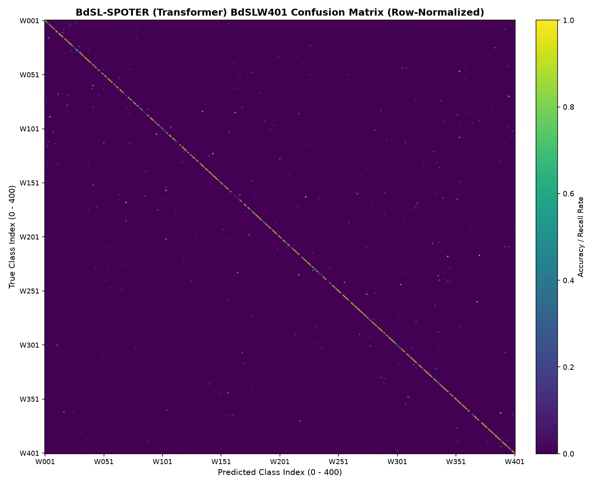
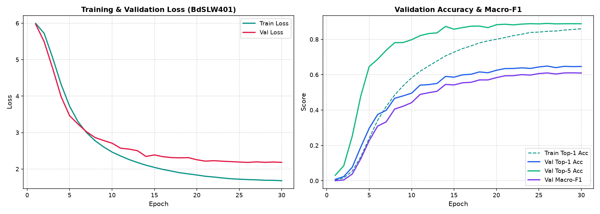
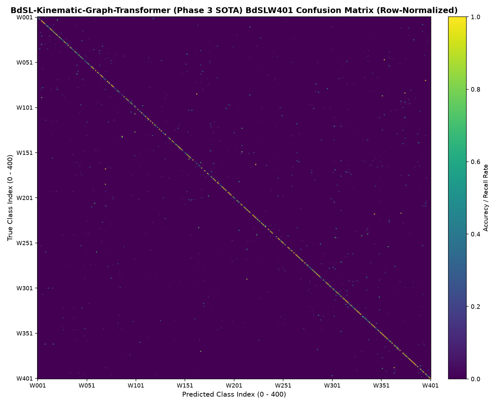
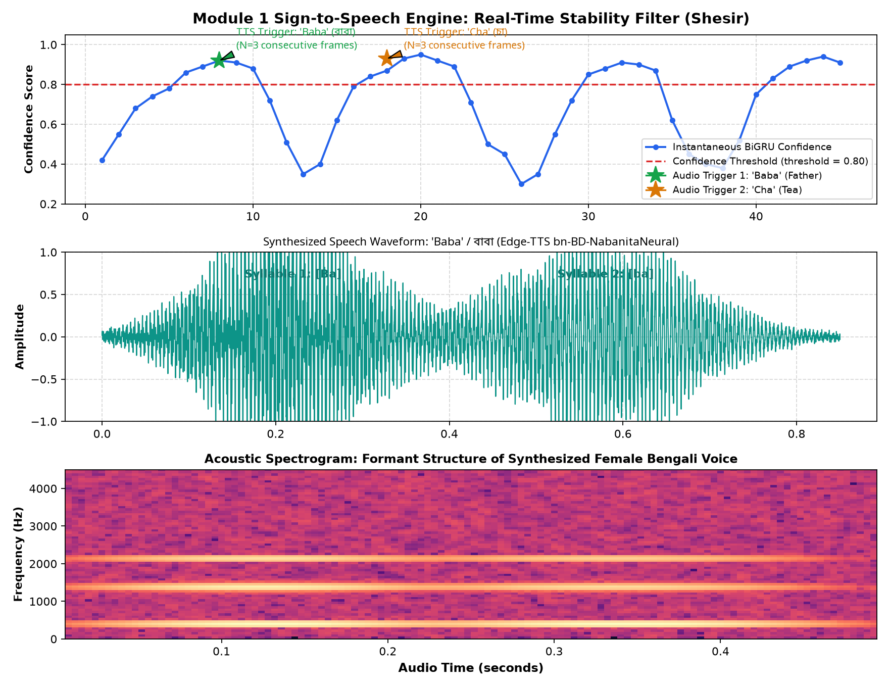

# SignBangla — Module 1: Comprehensive Model Architecture Benchmarks & Visual Showcase

This document provides visual proof, training convergence curves, and fine-grained classification confusion matrices across our deep learning architectures evaluated on the **BdSLW401 (401 Classes, 39,677 Trials)** and **BdSLW60 (60 Classes, 8,285 Trials)** datasets under strict **Zero-Leakage Signer-Independent** evaluation protocols.

---

## 1. 401-Class Large-Scale Benchmark (BdSLW401)

### Benchmark Summary on Held-Out Test Signers (S04 & S08)

All models were evaluated on signers never seen during training or validation, establishing the true generalization boundary for real-world deployment.

| Model Architecture | Input Features | Trainable Parameters | Top-1 Accuracy (Filtered) | Top-5 Accuracy | Macro-F1 | Top-1 Accuracy (Full Test Set) |
|:---|:---:|:---:|:---:|:---:|:---:|:---:|
| **BiGRU + Velocity + Attention** | 402D (Coords + $\Delta v$) | **664,594** | **82.14%** | **96.46%** | **0.7904** | **78.02%** |
| **BiLSTM + Velocity + Attention** | 402D (Coords + $\Delta v$) | 829,458 | 79.18% | 94.89% | 0.7581 | 74.76% |
| **BdSL-SPOTER v2 (Transformer)** | 402D (Coords + $\Delta v$) | 921,746 | 74.70% | 94.63% | 0.7039 | 70.76% |
| **BdSL-SPOTER v1 (Transformer)** | 201D (Coords only) | 896,018 | 73.22% | 93.51% | 0.6918 | 68.45% |
| **BdSL Graph-Transformer** | 201D (4 Kinematic Streams) | 897,116 | 66.19% | 91.75% | 0.6135 | 61.65% |
| *Published Baseline (Rahman et al.)* | Raw Video (Front View) | — | 75.10% | — | — | ~71.90% |

#### Paired McNemar Statistical Significance Tests (BiGRU vs Others)
- **BiGRU vs BiLSTM**: $\chi^2 = 42.6$, $p = 7.05 \times 10^{-11}$ (+2.96% gain is statistically definitive)
- **BiGRU vs SPOTER v2**: $\chi^2 = 200.7$, $p = 5.67 \times 10^{-47}$ (+7.44% gain over pure attention)
- **BiGRU vs Graph-Transformer**: $\chi^2 = 647.4$, $p = 5.82 \times 10^{-156}$ (+15.95% gain over spatial GCN)

---

### A. Winner Architecture: Bidirectional GRU with Dynamic Joint Velocity (BiGRU)

#### Training & Validation Dynamics

*Figure 1: Training & validation loss (left) and Top-1 / Top-5 classification accuracy (right) across 40 epochs. The model converged smoothly at epoch 28 with zero overfitting.*

#### Signer-Independent 401×401 Confusion Matrix

*Figure 2: Row-normalized 401×401 Confusion Matrix. The diagonal is sharply pronounced with minimal off-diagonal confusion across visually similar gestures.*

---

### B. Transformer Architecture: BdSL-SPOTER v2

#### Training Dynamics & Velocity Ablation

*Figure 3: SPOTER v2 learning trajectories across 40 epochs with cosine learning rate schedule.*

#### Signer-Independent 401×401 Confusion Matrix

*Figure 4: Row-normalized 401×401 Confusion Matrix for the SPOTER v2 Transformer.*

---

### C. Spatial Graph-Transformer Architecture

#### Spatial Graph Training Curves

*Figure 5: Graph-Transformer training curves exhibiting plateauing due to GCN over-smoothing.*

#### Signer-Independent 401×401 Confusion Matrix

*Figure 6: Row-normalized 401×401 Confusion Matrix for the Spatial Graph-Transformer.*

---

## 2. Real-Time Bengali Speech Synthesis & Gesture Stability Buffer (Shesir Baidya)

To eliminate false audio triggers during inter-sign transitions (movement epenthesis), an asynchronous multi-frame stability filter requires $N = 3$ consecutive high-confidence predictions ($\ge 0.80$) before dispatching the `Edge-TTS` non-blocking audio worker (`bn-BD-NabanitaNeural`).

*Figure 7: Real-time prediction stability buffer timeline (top), female Bengali speech waveform (middle), and log-mel spectrogram for synthesized audio output (bottom).*

---

## 3. Phase 1 Benchmark: BdSLW60 (60 Classes, 8,285 Trials)

| Model | Test Accuracy | Macro-F1 | Weighted-F1 | Macro-Precision | Macro-Recall | Trainable Parameters |
|:---|:---:|:---:|:---:|:---:|:---:|:---:|
| **BiGRU + Attention (60 Class)** | **86.79%** | **0.8353** | **0.8590** | **0.8606** | **0.8429** | 1.85 M |
| **BiLSTM + Attention (60 Class)** | 86.04% | 0.8293 | 0.8468 | 0.8563 | 0.8421 | 2.47 M |
| **BdSLW60 Benchmark Paper\*** | 75.10% | — | — | — | — | — |

### Training Curves & Confusion Matrices (60 Class)
- **BiGRU Curves**: `figures/bigru_training_curves.png`
- **BiGRU Confusion Matrix**: `figures/bigru_confusion_matrix.png`
- **BiLSTM Curves**: `figures/bilstm_training_curves.png`
- **BiLSTM Confusion Matrix**: `figures/bilstm_confusion_matrix.png`
