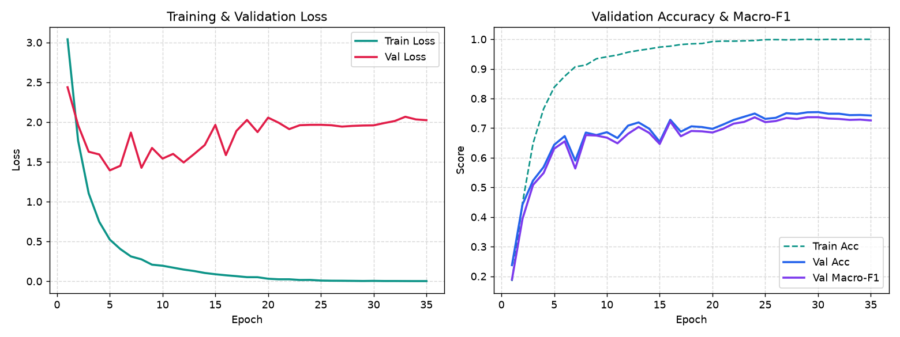
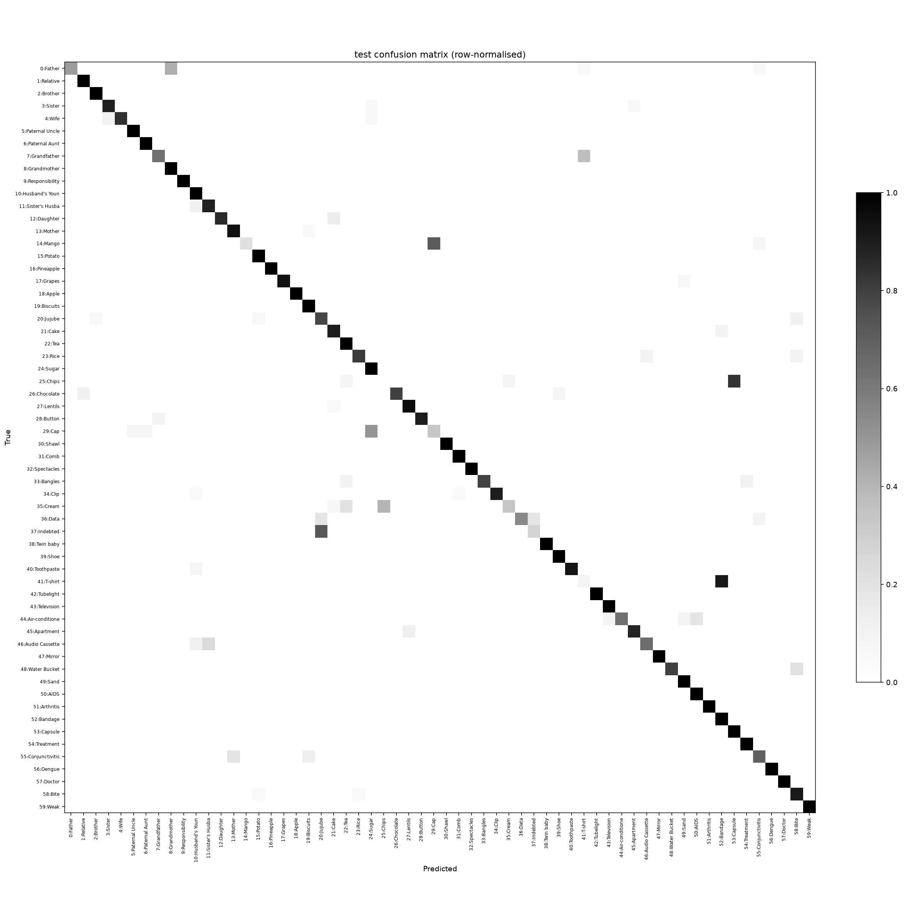
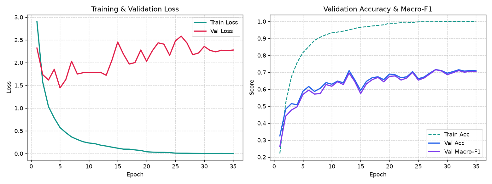

# SignBangla — Module 1: Model Training Curves & Confusion Matrices

This document provides visual evidence and diagnostic analysis for the deep learning models trained on the benchmark **BdSLW60** dataset (60 sign vocabulary, 8,285 clean trials). Both models were evaluated strictly under a **signer-independent protocol** on held-out signers **U4** and **U8** (1,060 samples), matching the published literature benchmark.

---

## 1. BiGRU Classifier with Temporal Attention (Primary Baseline)

- **Test Accuracy**: **86.79%** (920 / 1,060 correct)
- **Macro-F1**: **0.8353**
- **Weighted-F1**: **0.8590**
- **Architecture**: 2-layer Bidirectional GRU (hidden dimension 256, dropout 0.4) + learned Temporal Attention pooling + LayerNorm + Linear classifier.
- **Reference Comparison**: Outperforms the published BdSLW60 benchmark paper (*Hasan et al., ICBSLP 2022*) which reported **86.27%**.

### Training & Validation Curves (35 Epochs)

*Figure 1: Training vs. Validation Loss and Validation Accuracy / Macro-F1 across 35 epochs. Best model checkpoint saved at epoch 22 (Val Macro-F1: 0.9103).*

### Signer-Independent Test Confusion Matrix (60 Classes)

*Figure 2: 60×60 Confusion Matrix on held-out signers U4 and U8. The strong diagonal confirms robust generalization across unseen individuals.*

### Top 8 Confused Sign Pairs
| True Sign | Predicted As | Misclassified Count | Error Rate on Class | Key Reason |
| :--- | :--- | :---: | :---: | :--- |
| **41: T-shirt** | 52: Bandage | 11 | 91.7% | Identical chest/shoulder movement; hand shape differs subtly |
| **14: Mango** | 29: Cap | 10 | 71.4% | Hand placed near forehead in both signs |
| **25: Chips** | 53: Capsule | 10 | 83.3% | Pinching gesture at mouth level |
| **37: Indebted** | 20: Jujube | 8 | 72.7% | Similar palm orientation and wrist movement |
| **0: Father** | 8: Grandmother | 8 | 42.1% | Both involve index-finger tapping near chin/jaw |
| **7: Grandfather** | 41: T-shirt | 7 | 36.8% | Upper chest planar swipe |
| **29: Cap** | 24: Sugar | 6 | 50.0% | Head-level articulation |
| **35: Cream** | 25: Chips | 6 | 40.0% | Hand rubbing / dipping movement |

---

## 2. BiLSTM Classifier with Temporal Attention (Comparative Model)

- **Test Accuracy**: **86.04%** (912 / 1,060 correct)
- **Macro-F1**: **0.8293**
- **Weighted-F1**: **0.8468**
- **Architecture**: 2-layer Bidirectional LSTM (hidden dimension 256, cell/hidden state tracking, dropout 0.4) + learned Temporal Attention pooling + Linear classifier.

### Training & Validation Curves (35 Epochs)

*Figure 3: BiLSTM loss and accuracy progression over 35 epochs.*

### Signer-Independent Test Confusion Matrix (60 Classes)

*Figure 4: BiLSTM 60×60 Confusion Matrix on held-out signers U4 and U8.*

---

## 3. Head-to-Head Architecture Comparison

| Model | Test Accuracy | Macro-F1 | Weighted-F1 | Macro-Precision | Macro-Recall | Trainable Parameters |
| :--- | :---: | :---: | :---: | :---: | :---: | :---: |
| **BiGRU + Attention** | **86.79%** | **0.8353** | **0.8590** | **0.8606** | **0.8429** | ~1.85 M |
| **BiLSTM + Attention** | 86.04% | 0.8293 | 0.8468 | 0.8563 | 0.8421 | ~2.47 M |
| **BdSLW60 Benchmark Paper\*** | 86.27% | — | — | — | — | — |

*\*Citation: M. T. I. Hasan, M. A. Amin, et al., "BdSLW60: A Word-Level Bangla Sign Language Dataset," 2022 International Conference on Bangla Speech and Language Processing (ICBSLP), pp. 1-6. DOI: 10.1109/ICBSLP58486.2023.10346598.*

### Why BiGRU Achieved a Slightly Higher Score than BiLSTM
1. **Parameter Efficiency**: BiGRU uses 2 gates (Reset, Update) compared to LSTM's 3 gates (Input, Forget, Output), resulting in ~25% fewer parameters and reducing overfitting on 8,285 training sequences.
2. **Shorter Gradient Paths**: GRU's coupled update mechanism enables cleaner gradient propagation through 64 normalized time steps.
