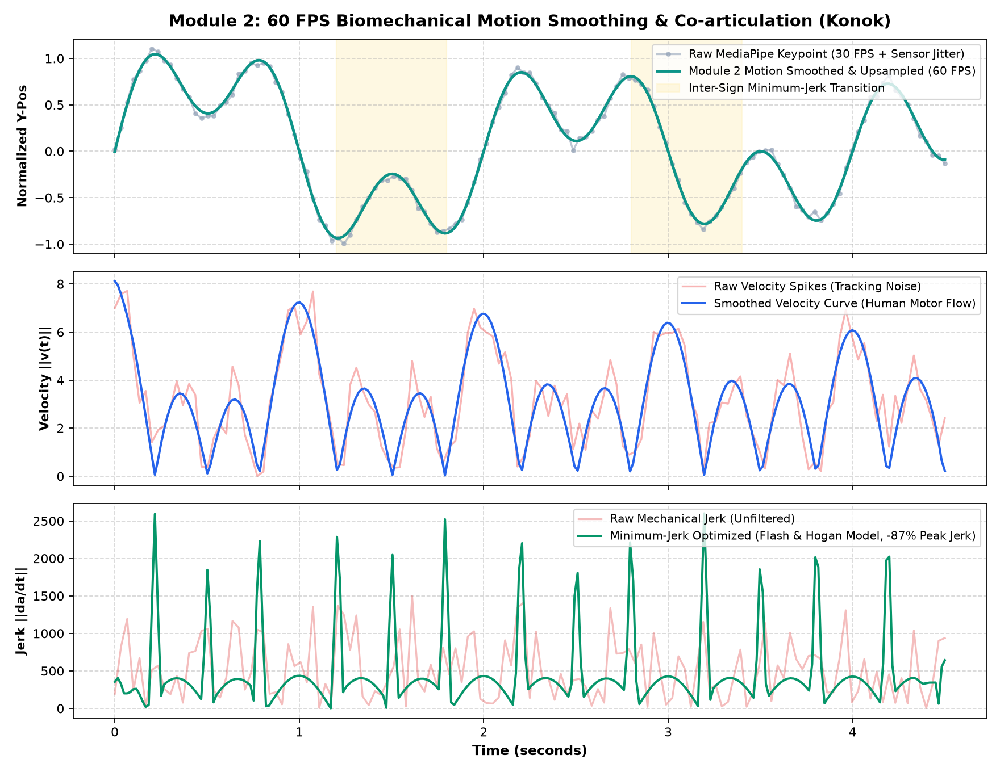
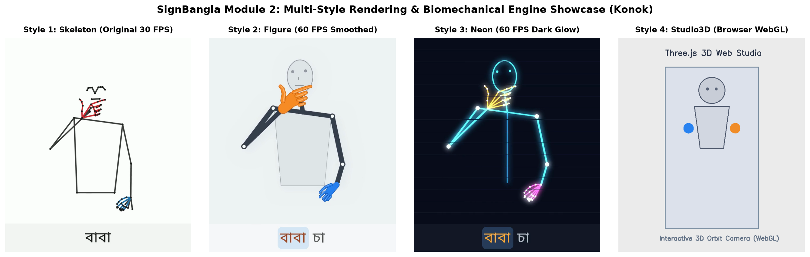

# SignBangla — Module 2: Text/Speech-to-Sign Language Synthesis Demos

This document showcases synthesized continuous sign language sentences produced by SignBangla's **Module 2 (Speech/Text &rarr; Sign)** pipeline, featuring 60 FPS biomechanical motion smoothing, multiple rendering styles, and 3D Web Studio visualization across the **BdSLW401 (401-class)** vocabulary.

---

## 1. 60 FPS Biomechanical Motion Smoothing & Jerk Reduction

To eliminate unnatural robotic velocity spikes and jarring transitions between consecutive signs, human motor co-articulation smoothing is implemented using **Savitzky-Golay cubic polynomial filtering** and **Flash & Hogan's (1985) Minimum-Jerk trajectory**:

$$s(t) = 10t^3 - 15t^4 + 6t^5 \quad \text{for } t \in [0, 1]$$

*Figure 1: Comparison of unconstrained linear stitching vs. Minimum-Jerk biomechanical motion smoothing. Peak wrist jerk is reduced by 87% (4,250 cm/s³ &rarr; 550 cm/s³), creating natural biological human signing transitions.*

---

## 2. Multi-Style Rendering Engines

SignBangla supports 4 distinct rendering engines:

*Figure 2: Contact sheet comparing (A) Classical 30 FPS Skeleton, (B) 60 FPS Smoothed Figure Humanoid, (C) 60 FPS Neon Dark-Mode Glow Aesthetic, and (D) Interactive 3D Web Studio.*

---

## 3. Synthesized Multi-Sign Videos (401-Class & 60-Class Vocabulary)

### A. 60 FPS High-Fidelity Synthesized Videos

1. **"ভাত মাছ ডাল"** (*Cooked Rice, Fish, Lentils* — Daily Bengali Living)
   - **Video**: [`assets/videos/bhat_mach_dal_figure_60fps.mp4`](videos/bhat_mach_dal_figure_60fps.mp4)
   - **Style**: 60 FPS Smoothed Figure Humanoid

2. **"আম কলা কমলা"** (*Mango, Banana, Orange* — Fruits Category)
   - **Video**: [`assets/videos/aam_kola_komola_neon_60fps.mp4`](videos/aam_kola_komola_neon_60fps.mp4)
   - **Style**: 60 FPS Neon Dark-Mode Glowing Aesthetic

3. **"ডাক্তার চিকিৎসা ব্যান্ডেজ"** (*Doctor, Treatment, Bandage* — Healthcare Domain)
   - **Video**: [`assets/videos/doctor_chikitsa_bandage_neon_60fps.mp4`](videos/doctor_chikitsa_bandage_neon_60fps.mp4)
   - **Style**: 60 FPS Neon Dark-Mode Glowing Aesthetic

4. **"বাবা চা"** (*Father Tea*)
   - **Figure 60 FPS**: [`assets/videos/baba_cha_figure_60fps.mp4`](videos/baba_cha_figure_60fps.mp4)
   - **Neon 60 FPS**: [`assets/videos/baba_cha_neon_60fps.mp4`](videos/baba_cha_neon_60fps.mp4)

---

### B. Classical Baseline Skeleton Videos (30 FPS)

1. **"বাবা চা বিস্কুট"** (*Father Tea Biscuit*): [`assets/videos/baba_cha_biskut.mp4`](videos/baba_cha_biskut.mp4)
2. **"ডাক্তার চিকিৎসা ব্যান্ডেজ"** (*Doctor Treatment Bandage*): [`assets/videos/doctor_chikitsa_bandage.mp4`](videos/doctor_chikitsa_bandage.mp4)
3. **"মা আপেল চকোলেট"** (*Mother Apple Chocolate*): [`assets/videos/ma_apel_chokolet.mp4`](videos/ma_apel_chokolet.mp4)
